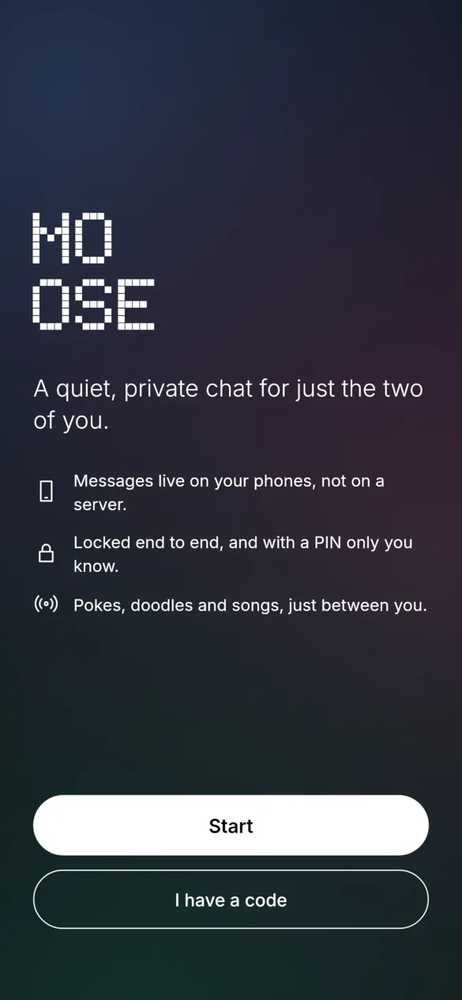
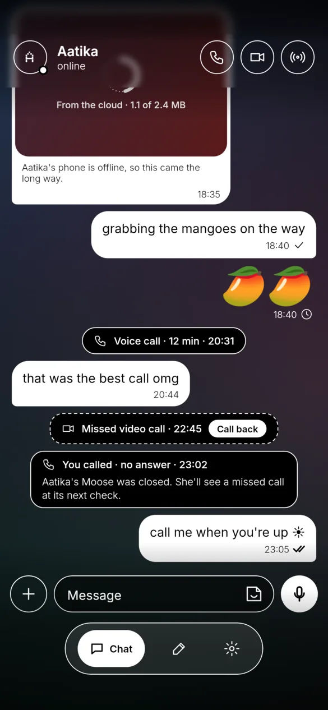
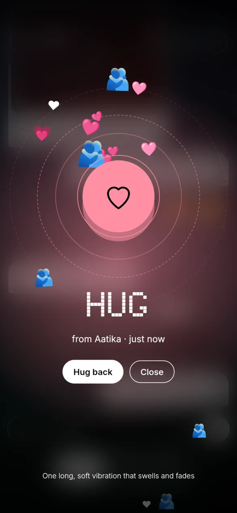
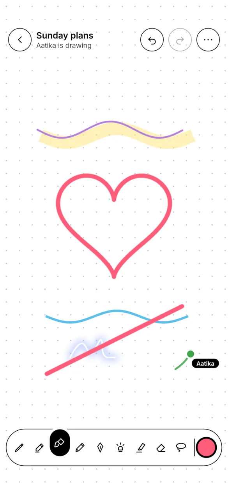
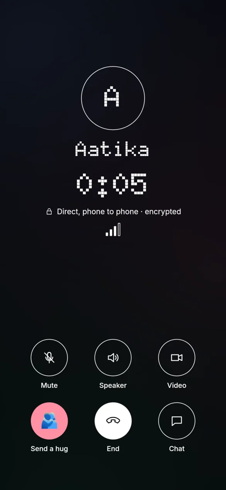
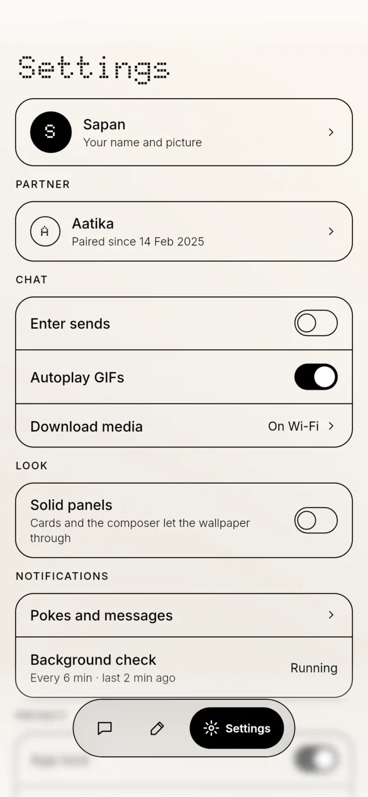
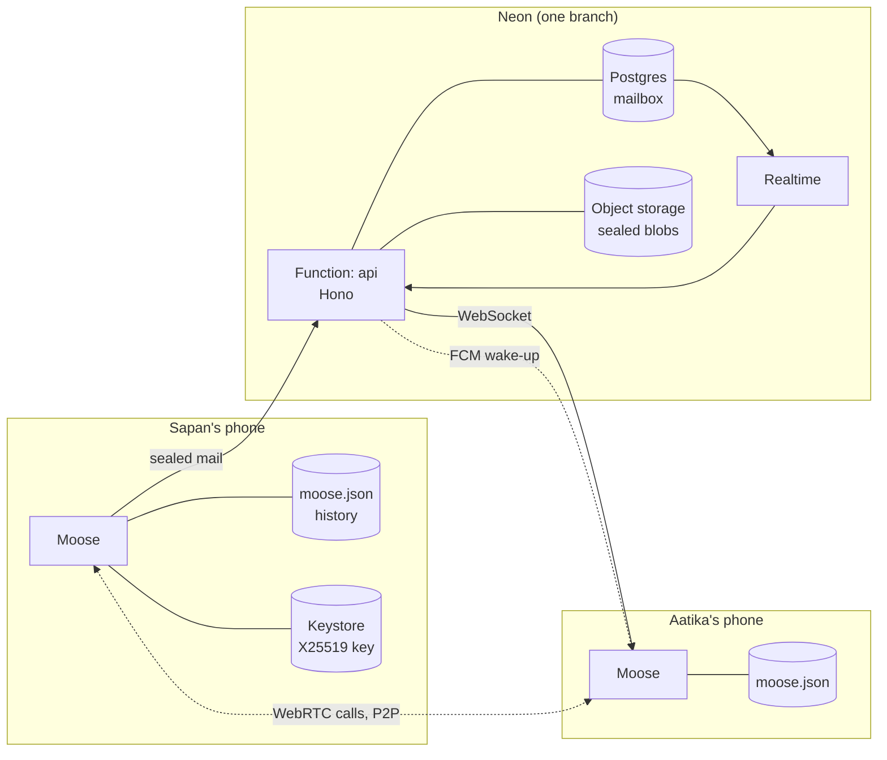
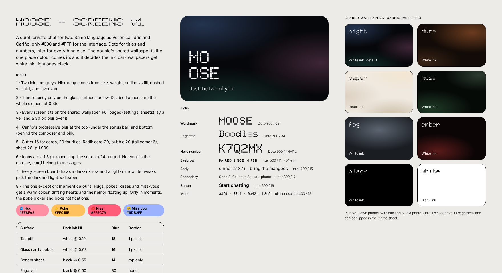

<div align="center">



# Moose

**A quiet, private chat for two.**

One app, one couple. Messages live on your two phones, and the server only holds sealed mail until it's delivered.

    

</div>

<p align="center">
  
  
  
  
  
</p>

---

## What it is

Moose is a Flutter chat app for **exactly two people**: a paired couple. Sapan wrote it for himself and his partner, as a sibling of his apps Veronica, Idris and Cariño, and it shares their design language: two inks, Doto and Inter, and one shared wallpaper as the only colour.

There are no accounts, phone numbers or contact lists. You pair once, with a six-character code or a QR, and from then on everything you send is encrypted on your phone and opened on theirs.

## Features

| | |
| --- | --- |
| 💬 **Messaging** | End-to-end encrypted text, replies, reactions, delivery and seen receipts, and typing. History lives in a file on each phone. |
| 📷 **Media** | Photos, videos and voice notes; round video notes; 15-second song clips from YouTube; memes and GIFs (Reddit, or KLIPY with a key). Media is sealed with its own key and deleted from storage once it's opened. |
| 🫂 **Moments** | Poke, Hug, Kiss and Miss you, each with a full-screen burst, its own colour and its own haptic. |
| 🩷 **Stickers** | Your own library: photo cut-outs (ML Kit subject segmentation) and stickers drawn on a doodle. |
| ✏️ **Doodles** | Shared drawing boards with nine tools, a colour wheel, a lasso and live presence. |
| 📞 **Calls** | Peer-to-peer voice and video over WebRTC, set up through sealed messages. |
| 🎨 **Shared theme** | Eight palettes or your own photo, with dim and blur. Either of you can change it for both. |
| 🔒 **App lock** | A PIN, plus a decoy PIN that opens an empty chat with someone else. |
| 🔔 **Delivery** | Live WebSocket while open, Firebase push when not, and a 6-minute background check as a safety net. |
| ⬆️ **Updates** | Moose updates itself from GitHub Releases, verifying size, SHA-256 and signer first. |

Every screen comes in both inks: white on dark wallpapers and black on light ones. See the **[gallery](docs/gallery.md)** for all of them.

## How it works



1. Each phone makes an **X25519 identity** on first launch and keeps it in the Android Keystore.
2. **Pairing** swaps public keys through the server. Both phones show the same 60-digit security code, so you can check nobody is in the middle.
3. Every message is a **sealed box** (XChaCha20-Poly1305). The server stores it in `mailbox`, pushes it over Realtime, and deletes it once the other phone acks it.
4. **Media** is encrypted with a fresh key, uploaded to a private bucket, and its key travels inside a sealed message. The receiver downloads it, then deletes it.
5. When the app is closed, a **data-only Firebase push** wakes it, and a **quiet foreground service** checks every 6 minutes in case push doesn't get through.

There's more in [Architecture](docs/architecture.md), [Security and privacy](docs/security.md) and [Delivery](docs/delivery.md).

## Quick start

```bash
flutter pub get
flutter run                     # mock mode: a fake partner, no server needed
```

Without `env.json`, Moose runs on **mocks**: a pretend Aatika who types, replies, sends moments and answers calls. Every widget test runs this way.

To run against a real backend, copy `env.example.json` to `env.json`, fill in your Neon URLs, and build with it:

```bash
flutter run --dart-define-from-file=env.json
```

The full setup is in [Development](docs/development.md): the backend, the phone, the Linux build, signing and tests.

## Documentation

| Doc | What's in it |
| --- | --- |
| [Architecture](docs/architecture.md) | Layers, the repository pattern, mock vs Neon, state, the local store and the code map |
| [Security and privacy](docs/security.md) | Identity, sealing, media keys, security codes, app lock and decoy, and what the server can see |
| [Delivery](docs/delivery.md) | The mail lifecycle, Realtime, push, the background check and call signalling |
| [Features](docs/features.md) | Each feature, how it behaves and how it's built, with screens |
| [Development](docs/development.md) | Setup, running on the phone and Linux, conventions, tests and renders |
| [Releases and OTA](docs/releases.md) | CI, signing, versioning and the self-updater |
| [Gallery](docs/gallery.md) | Every app screen in both inks, and every design board |
| [Design spec](design/DESIGN.md) | Inks, type, surfaces, moment colours and layout |
| [Screen inventory](design/SCREENS.md) | Every page, state and component |
| [Mock data](mockdata.md) | Every mock dataset and widget stand-in, and whether it's real yet |
| [Backend](backend/README.md) | The Neon Function, schema, endpoints and scripts |

## Design

<p align="center">
  
</p>

Moose follows the **Moose Screens** design canvas in [`design/canvas/`](design/canvas/), rendered to [`design/screens/`](design/screens/).

- **Two inks only:** `#000` and `#FFF`, with no greys. Hierarchy comes from size, weight, outline vs fill and inversion.
- **The wallpaper decides the ink:** dark wallpapers get white, light ones black.
- **Moment colours** are the one exception: Poke `#FFC15E`, Hug `#FF8FA3`, Kiss `#FF5C7A`, Miss you `#9DB2FF`.
- **Blur in exactly three places:** the progressive edge blur at the top and bottom (a fragment shader), the frosted tab pill, and behind a moment burst. Everything else is see-through paper or solid.

All 18 boards are in the [gallery](docs/gallery.md#design-boards).

## Tech

| Layer | Choice |
| --- | --- |
| UI | Flutter, `CupertinoApp` (no Material), go_router, Riverpod 3 |
| Crypto | `cryptography`: X25519, XChaCha20-Poly1305, SHA-256 |
| Backend | Neon: Managed Auth, Postgres, Realtime, Object Storage, and a Function (Hono, TypeScript) |
| Push | Firebase Cloud Messaging (data-only) and flutter_local_notifications |
| Background | flutter_foreground_task (6-minute check) |
| Calls | flutter_webrtc, STUN only |
| Media | camera, image_picker, record, just_audio, video_player, media_kit on Linux |
| Songs | youtube_explode_dart, and NewPipe Extractor through a Kotlin channel |
| Stickers | google_mlkit_subject_segmentation |
| Updates | GitHub Releases, `update.json` and a PackageInstaller session |

## Platforms

- **Android** (arm64) is the main target, released signed through GitHub Releases.
- **Linux** desktop works as a second device: the same pairing and chat. It has no push and no background check (FCM and foreground services are Android-only), no ML Kit cut-outs, and keeps its secrets in a private `vault.json` instead of the Keystore.

## Licence and credits

- **Fonts:** [Doto](https://fonts.google.com/specimen/Doto) and [Inter](https://rsms.me/inter/), both SIL OFL (see `assets/fonts/`).
- **Wallpaper palettes and edge blur:** from Cariño. The **About** page layout is from Idris.
- **Author:** Sapan Gajjar ([@isg32](https://github.com/isg32)).
