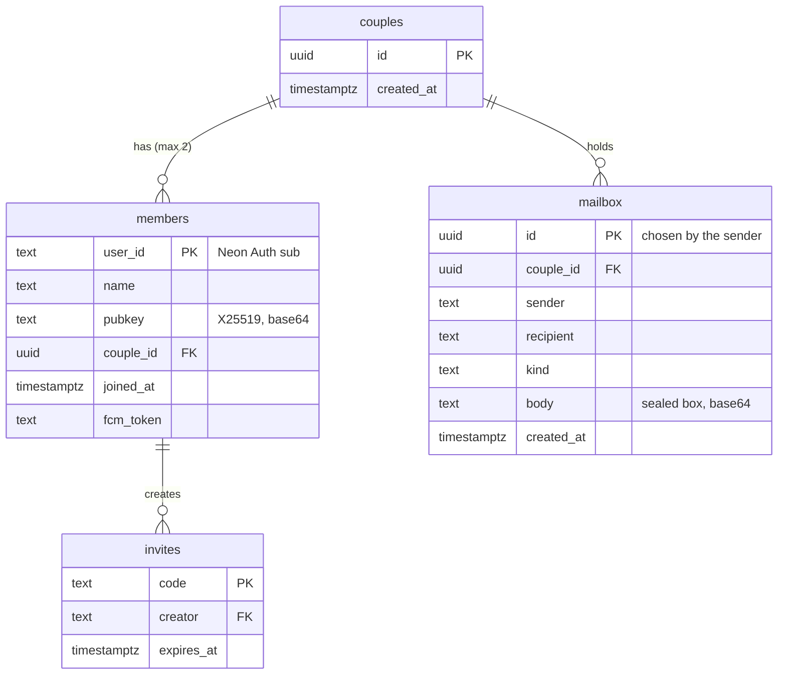

# Moose backend (Neon)

One Neon branch, declared in `neon.ts`. **The server never sees plaintext**: bodies and blobs are encrypted on the phone, and the API only routes them. See [`docs/delivery.md`](../docs/delivery.md) and [`docs/security.md`](../docs/security.md) for the whole picture.

| Service | Used for |
| --- | --- |
| Managed Auth | A hidden email/password account per phone. The app sends its 15-minute JWT to the API, which checks it against the branch's JWKS |
| Postgres | `couples`, `members` (name, X25519 public key, FCM token), `invites`, and `mailbox` (sealed envelopes, deleted on ack). Schema: `db/schema.sql` |
| Function `api` | `src/api.ts` (Hono). Every route the phones call |
| Realtime | `/v1/live` subscribes to the member's mailbox rows and pushes each new one over a WebSocket |
| Object storage | The private bucket `assets`: sealed media under `c/<couple>/<uuid>`, through presigned URLs |
| Firebase (outside Neon) | `src/push.ts`: data-only FCM HTTP v1 pushes, signed with a service account |

## Setup

```bash
npx -y neon@latest env pull   # writes .env.local (git-ignored)
npm install
npm run build                 # type-check
npm run migrate               # apply db/schema.sql
npm run deploy                # neon deploy --env .env.local (adds FIREBASE_SA_B64 if firebase-sa.json is here)
npm test                      # end to end against the deployed branch
npm run cleanup               # delete the e2e-…@moose.app test accounts
```

The Function's URL goes into the app's `env.json` as `MOOSE_API_URL`, and Managed Auth's base URL as `MOOSE_AUTH_URL`.

**Function environment** (from `neon.ts`):

| Variable | |
| --- | --- |
| `REALTIME_URL`, `REALTIME_SECRET` | Realtime, passed under non-reserved names because Functions don't get `NEON_REALTIME_*` |
| `MOOSE_BUCKET` | `assets` |
| `FIREBASE_SA_B64` | Optional: base64 of `firebase-sa.json`. Without it, no push |

Preview branches made by the CLI expire after 7 days.

## Schema



`mailbox` keeps a primary key and **no RLS**, because Realtime reads it. The API authorises every query itself, and there's no Data API.

## Endpoints

Everything under `/v1` needs `Authorization: Bearer <jwt>`, or `?token=<jwt>` on the WebSocket.

| Method | Path | Does |
| --- | --- | --- |
| `GET` | `/` | Health check |
| `GET` | `/v1/me` | You and your partner: name, public key, couple and paired-since date |
| `PUT` | `/v1/me` | Set any of `name` (≤ 40), `pubkey` and `fcm` (the push token; `''` forgets it) |
| `POST` | `/v1/invites` | A fresh six-character code, live for 10 minutes |
| `GET` | `/v1/invites/:code` | Who made the code (name and public key) without joining it, used to check a re-pair |
| `POST` | `/v1/join` | Join a code. If you're already paired, the code's creator takes your old phone's place (re-pair). 404 when it expired or was used |
| `POST` | `/v1/unpair` | Leave the couple |
| `POST` | `/v1/mail` | `{id, kind, body}` to your partner. Idempotent on `id`. Pushes for `msg`, `moment` and `call` |
| `GET` | `/v1/mail` | Up to 500 waiting envelopes, oldest first (catch-up and the background check) |
| `POST` | `/v1/mail/ack` | `{ids}`: delete delivered envelopes. Also drops anything over 30 days old |
| `GET` | `/v1/live` | WebSocket. Sends `{"type":"mail",…}` for each new envelope, `{"type":"ping"}` every 25 s, `{"type":"state"}` on Realtime changes, and `{"type":"poll"}` when Realtime isn't configured |
| `POST` | `/v1/blobs` | A new key under your couple and a presigned PUT URL (10 minutes) |
| `GET` | `/v1/blobs?key=` | A presigned GET URL for a key under your couple |
| `DELETE` | `/v1/blobs?key=` | Delete a blob once it's been fetched |

**Limits:** a mail body can be at most 256 KB; media goes to the bucket. Mail kinds are `msg`, `receipt`, `typing`, `moment`, `theme`, `doodle`, `rtc` and `call`. Blob keys must be `c/<your couple>/<uuid>`, or the API answers 403.

## Scripts

| Script | Does |
| --- | --- |
| `scripts/migrate.ts` | Applies `db/schema.sql` (idempotent) |
| `scripts/cleanup.ts` | Deletes the end-to-end test accounts and their rows |
| `scripts/push-check.ts` | Lists members and whether each has a push token; `… send <name>` sends that member a test "New message" |
| `test/e2e.ts` | Two pretend phones and a stranger, against the deployed branch: sign-up and sessions, forged tokens refused, pairing, a stranger can't write, live mail over Realtime, push tokens, list and ack, sealed blobs, re-pair and unpair. Everything it makes is deleted |
