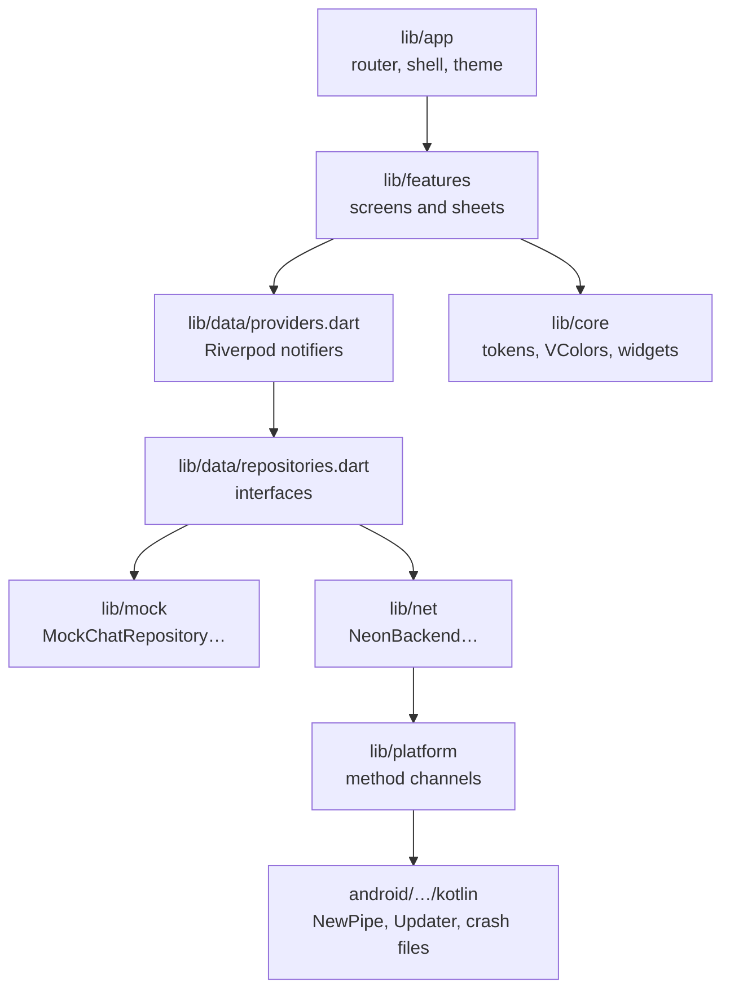

# Architecture

Moose is one Flutter app with two backends behind the same interfaces: **mocks**, with a pretend partner, and **Neon**, the real one. Which one runs is decided once, in `lib/main.dart`, by whether the build has an `env.json`.



## Layers

| Folder | Role | Depends on |
| --- | --- | --- |
| `lib/app` | The root: `MooseApp`, the router, the tab shell, the shared wallpaper and the version | everything below |
| `lib/core` | Design tokens, `VColors`, `VText`, icons and the shared widget kit (`VGlass`, `VEdgeBlur`, `VRing`, `VMarquee`, `VMotionBlur`…) | Flutter only |
| `lib/features` | Screens, one folder per area | `core`, `data` |
| `lib/data` | Models, repository interfaces, Riverpod providers and the session | nothing app-specific |
| `lib/mock` | The mock repositories and sample data | `data` |
| `lib/net` | The real backend: API client, crypto, wire format, local store, push, background check, device features and the updater | `data`, `platform` |
| `lib/platform` | Thin method-channel wrappers | Kotlin side |

Features never import `lib/net` or `lib/mock`; they only see `lib/data`. That's what lets every widget test run the real screens against mocks.

## Mock or Neon

```dart
final config = NeonConfig.fromEnvironment;          // from --dart-define-from-file=env.json
final backend = config == null ? null : await NeonBackend.open(config, …);
runApp(ProviderScope(overrides: [...?backend?.overrides(), …], child: const MooseApp(splash: true)));
```

- **No `env.json`:** the providers keep their defaults, the `Mock…Repository` classes. The mock partner answers within seconds, so the whole app can be clicked through offline.
- **With `env.json`:** `NeonBackend.overrides()` swaps in `NeonPairRepository`, `NeonChatRepository` and the stored doodle and sticker repositories, and `main.dart` adds the device features: YouTube songs, web memes, phone storage, the background check, the updater (Android) and round video (Android).

Device features that the mocks can't provide (`MediaSource`, `Voice`, `SongPlayer`, `RoundCamera`, `CallLink`) are nullable providers. A screen that finds `null` shows the mock behaviour or hides the control.

[`mockdata.md`](../mockdata.md) tracks every mock dataset and every value drawn straight into a widget, and whether it's real yet.

## Repositories

`lib/data/repositories.dart`:

| Interface | Does | Neon implementation |
| --- | --- | --- |
| `PairRepository` | Who you're paired with, invites, joining, re-pair, unpair, security code | `NeonPairRepository` |
| `ChatRepository` | Send, react, receipts, typing, moments, media, theme, calls; and a stream of `ChatEvent`s | `NeonChatRepository` |
| `DoodleRepository` | Boards and their stroke ops | `_StoredDoodles` (synced as sealed mail) |
| `StickerRepository` | Packs and favourites | `_StoredStickers` (kept in `moose.json`) |
| `MemeRepository` | Meme and GIF search | `WebMemes` (Reddit via meme-api.com, KLIPY with a key) |
| `MusicRepository` | Song search | `YouTubeSongs` |
| `StorageRepository` | Space used by kind, and clearing | `PhoneStorage` |

`ChatRepository.events` is a sealed `ChatEvent` hierarchy: `Incoming`, `DeliveryUpdate`, `TypingChanged`, `MomentArrived`, `CallArrived`, `ReactionChanged`, `MediaReady`, `UploadProgress`, `DoodleChanged`, `PartnerChanged`, `ThemeChanged`, `OnlineChanged`, `Unpaired` and `RepairRequested`. The notifiers in `providers.dart` fold these into state.

## State

Riverpod 3 notifiers in `lib/data/providers.dart`:

| Provider | Holds |
| --- | --- |
| `sessionProvider` | Paired or not, locked or not, PIN, decoy PIN and decoy name, wrong tries |
| `pairingProvider` | You, your partner, paired-since date and security code |
| `messagesProvider` | The conversation, applying `ChatEvent`s |
| `chatThemeProvider` | The shared wallpaper: palette or photo, dim, blur and ink |
| `doodlesProvider`, `stickersProvider` | Boards and the sticker library |
| `momentCooldownProvider`, `incomingMomentProvider` | The 10-second cooldowns, and the burst to show |
| `incomingCallProvider`, `inCallProvider` | Call state |
| `playbackProvider` | Which song, voice note or round video is playing, and where |
| `settingsProvider`, `storageProvider`, `onlineProvider` | Settings, storage use and connection |

## Messages

`Message` (in `lib/data/models.dart`) has an id, `fromMe`, time, delivery state, reply, reactions and a sealed `Body`:

`TextBody` · `PhotoBody` · `VideoBody` · `RoundVideoBody` · `VoiceBody` · `MusicBody` · `MemeBody` · `StickerBody` · `MomentBody` · `CallBody` · `SystemBody`

On the wire they're turned into JSON by `lib/net/wire.dart`, inside a sealed envelope. `fromMe` is never sent: the receiver flips it. File paths are kept in the store but never put on the wire. See [Delivery](delivery.md#the-wire-format).

## The local store

The conversation lives **on the phone**, not on the server.

| Where | What | How |
| --- | --- | --- |
| `moose.json` (app support folder) | Pairing, partner, messages, doodles, stickers, theme, settings, profile pictures | `LocalStore`: JSON, written shortly after a change; writes queue so two never race on the temp file |
| Vault | The X25519 identity, the hidden account's credentials and the session cookie | `SecureVault` (Android Keystore through flutter_secure_storage), `FileVault` (a private `vault.json` on Linux), `MemoryVault` (tests) |
| Media folder | Photos, videos, voice notes, round videos, stickers and wallpapers | Plain files, measured and cleared by `PhoneStorage` |

Unpairing wipes the partner and the conversation. Uninstalling wipes the identity, so the phone has to pair again.

## Navigation

`lib/app/router.dart` (go_router):

```
/welcome ── name ── background ── pair ── waiting
                                └ join ── scan
/paired
/ (shell) ── /chat · /doodles · /settings
```

- **The shell** (`shell.dart`) holds the three tabs, the frosted tab pill, the edge blurs (drawn once, outside the tab switch), the tab-switch cover and the update listener.
- **Redirects** follow `sessionProvider`: unpaired goes to onboarding, and locked shows the lock screen over everything.
- **Transitions:** setup steps use `stepTransition` (the old step blurs out to the left, then the new one blurs in). Pushed pages, overlays and sheets use `VMotionBlur`. A covered page **stays in the tree** at opacity 0, never swapped for a placeholder; `test/step_transition_test.dart` guards this, because breaking it broke QR pairing.

## The wallpaper and surfaces

`lib/app/moose_theme.dart` paints the shared wallpaper once, behind everything, and works out the ink. Pages lay a `VVeil` over it: a copy of the wallpaper under the tint, opaque from the first frame, so nothing "pops" during a fade. Panels are see-through paper (cards 55 %) or solid (Settings › Look › Solid panels, `VPanels`), and sheets are always solid. The only live blurs are the shader edge blur (`shaders/progressive_blur.frag`) and the tab pill.

## Platform code

| Dart | Kotlin | Does |
| --- | --- | --- |
| `platform/youtube.dart` | `youtube/YouTubeChannel.kt` | NewPipe Extractor stream lookup (first choice for song clips) |
| `platform/updater_channel.dart` | `Updater.kt` | PackageInstaller session, install receivers and the signer check |
| `platform/secure_window.dart` | `MainActivity.kt` | `FLAG_SECURE` for "Hide in recent apps" |
| `platform/crash_log.dart` | `CrashFiles.kt` | Saving crash reports to Downloads, and native crashes from the last run |

## Code map

| Area | Files |
| --- | --- |
| Onboarding and pairing | `features/onboarding/onboarding_pages.dart`, `pair_card.dart`, `step_page.dart` |
| Lock and decoy | `features/lock/lock_pages.dart`, `features/common/keypad.dart` |
| Chat | `features/chat/chat_page.dart`, `bubbles.dart`, `composer.dart`, `message_actions.dart`, `theme_sheet.dart`, `chat_hooks.dart` |
| Media | `features/media/attach_sheet.dart`, `media_pages.dart`, `media_viewer.dart` |
| Songs | `features/music/music_pages.dart`, `net/phone_songs.dart`, `platform/youtube.dart` |
| Moments | `features/moments/moment_burst.dart`, `moment_flight.dart`, `poke_picker.dart` |
| Stickers | `features/stickers/tray.dart`, `sticker_maker.dart`, `cutout.dart` |
| Doodles | `features/doodles/doodles_page.dart`, `board_page.dart`, `doodle_sheets.dart`, `paper.dart`, `features/common/strokes.dart` |
| Calls | `features/calls/call_page.dart`, `net/neon_calls.dart` |
| Settings | `features/settings/settings_page.dart`, `settings_pages.dart`, `update.dart` |
| Crashes | `features/crash_overlay.dart`, `platform/crash_log.dart` |
| Backend | `net/neon_backend.dart`, `api.dart`, `auth.dart`, `crypto.dart`, `wire.dart`, `local_store.dart`, `vault.dart` |
| Delivery | `net/push.dart`, `net/background_check.dart` |
| Updates | `net/updater.dart`, `platform/updater_channel.dart`, `android/…/Updater.kt` |

The codebase is about 29,000 lines of Dart in `lib/`, plus the Kotlin channels and the TypeScript Function in `backend/`.
