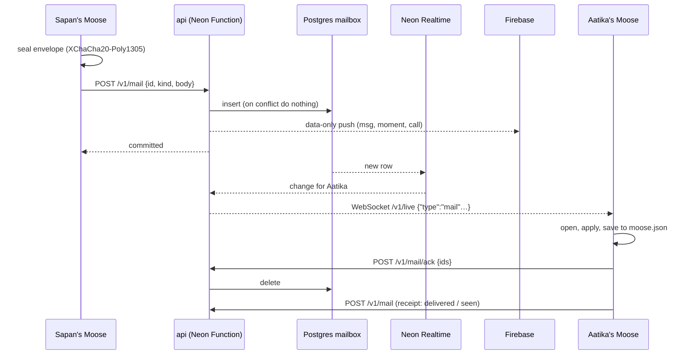
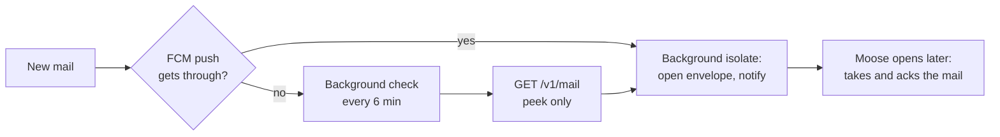
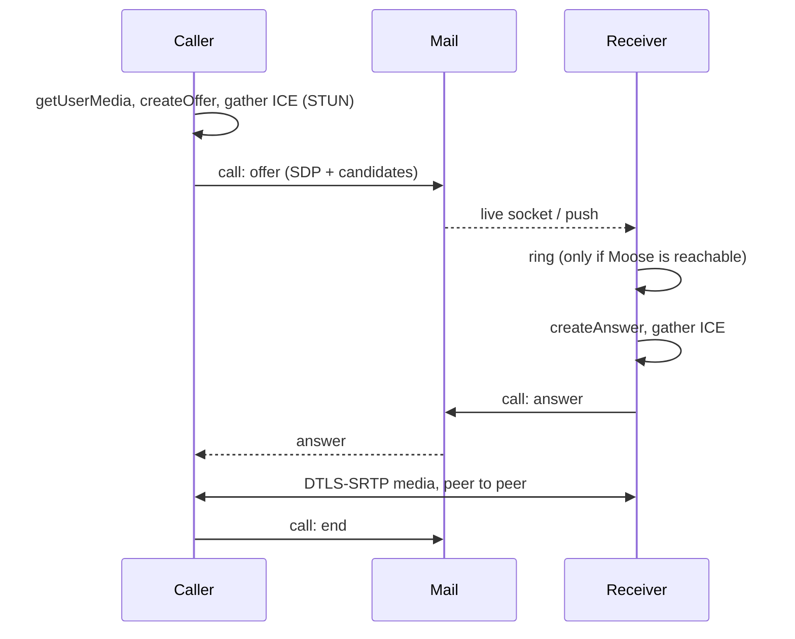
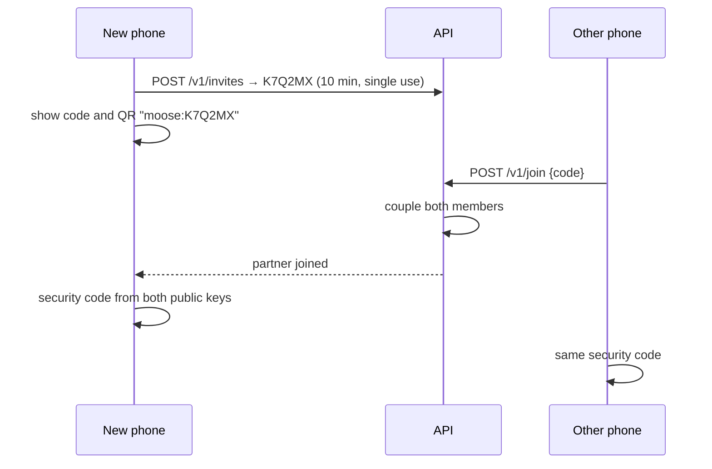

# Delivery

How a message gets from one phone to the other, whether Moose is open, in the background or closed.

## The mail lifecycle

1. **Send:** the phone picks a UUID, seals the envelope and posts it. Posting the same id twice stores it once, so retries are safe.
2. **Store:** a single SQL statement inserts into `mailbox`, taking the couple and the recipient from the sender's membership, so a member can only ever write to their own partner.
3. **Wake:** for `msg`, `moment` and `call`, the API sends a data-only, high-priority FCM push. It carries the sealed body when it's under 3 KB. A token that FCM reports as unregistered is cleared.
4. **Deliver:** if the partner's Moose is connected, Realtime sees the new row and the API forwards it over the WebSocket.
5. **Apply and ack:** the phone opens a batch, applies it, saves it, then acks the ids, and the server deletes them. Anything left over 30 days is dropped too.
6. **Receipts:** the receiver sends `receipt` envelopes back: delivered when the mail lands, and seen when the chat is on screen.

## Envelope kinds

| Kind | Carries | Pushed |
| --- | --- | --- |
| `msg` | A message: text, media reference, sticker, song, meme, or a reaction or reply | ✓ |
| `receipt` | Delivered or seen, for a list of ids | |
| `typing` | Typing started or stopped | |
| `moment` | Poke, Hug, Kiss or Miss you | ✓ |
| `theme` | The shared wallpaper (last write wins) | |
| `doodle` | A board op: create, strokes, rename, delete or presence | |
| `call` | A call's offer, answer, decline and end, and the call's row in the chat | ✓ |
| `rtc` | Accepted by the server, but not used by this version | |

The server only sees the kind. Inside, `lib/net/wire.dart` defines the plaintext both phones agree on: `MessageEnvelope`, `ReceiptEnvelope`, `TypingEnvelope`, `ReactEnvelope`, `CallEnvelope`, `ProfileEnvelope`, `DoodleEnvelope` and `ThemeEnvelope`.

## The wire format

- **JSON inside the sealed box.** `fromMe` is never sent: the receiver flips it. Doodle strokes swap `me` and `partner` on arrival.
- **Local-only fields** (file paths, download state) are kept in `moose.json` but stripped before sealing.
- **Forward compatibility:** an envelope type this version doesn't know decodes to `null` and is skipped, not crashed on.
- **Size:** the API rejects bodies over 256 KB. Anything big goes through storage as a sealed blob (see [Security](security.md#sealing-media)).

## While Moose is open

`NeonChatRepository` (`lib/net/neon_backend.dart`):

- **Live socket:** it connects to `/v1/live?token=<jwt>`, catches up with `GET /v1/mail`, then listens. When the socket drops it backs off (2 s, doubling up to 30 s) and reconnects.
- **Safety-net poll:** it catches up every 30 s too, because Realtime doesn't promise every change.
- **Push while open:** an FCM message calls `backend.wake`, which catches up at once.
- **Typing and presence:** typing travels as mail, so "online" means "typing recently or connected". There's no separate presence channel.
- **Seen:** while the chat is on screen, new messages are marked seen straight away.

## While Moose is in the background

The live socket keeps running for a while. When mail arrives, `notifyAway` turns it into a local notification with the same text a push would have shown.

## While Moose is closed

- **Push** (`lib/net/push.dart`): a background handler opens the sealed body with the vault's key, and shows "New message" (previews are off by default) or the moment on its own channel. It never acks.
- **The background check** (`lib/net/background_check.dart`): a quiet `flutter_foreground_task` service looks for mail **every 6 minutes**, chosen to keep Neon's compute within the free plan. It notifies about new mail but never takes it. Moose asks to skip battery optimisation so the check runs on time. Settings › Notifications shows when it last ran.
  - `--dart-define=MOOSE_CHECK_EVERY=<seconds>` shortens the interval for tests.
- **Taking the mail:** only the open app applies and acks, so nothing is lost if a notification is swiped away.

## Notification channels

| Channel | For |
| --- | --- |
| Messages (`messages`, high) | "New message", or a preview when you've turned them on |
| Pokes and hugs (`moments`, max) | Moments, and incoming calls while Moose is closed |
| Background check (`background`) | The quiet ongoing notification the foreground service needs |
| Updates (Kotlin, `Updater.kt`) | "Moose updated to X", after an over-the-air install |

## Calls

- Each SDP carries its ICE candidates, so a call needs just **two messages** to connect (no trickle ICE).
- Signalling is ordinary sealed mail, so it works over the same socket and push as everything else.
- **STUN only:** Google's public STUN servers, and no TURN, so some networks can't connect.
- **A call rings only while the partner's Moose can be reached.** Otherwise it shows as "no answer", and the partner sees a missed call at their next check (up to 6 minutes).
- The **caller** writes the call's row in the chat (done, missed, or no answer) for both phones.

Code: `lib/net/neon_calls.dart` (`NeonCalls`, flutter_webrtc) and `lib/features/calls/call_page.dart`.

## Pairing

- **Codes** are six characters from `ABCDEFGHJKLMNPQRSTUVWXYZ23456789` (no 0/O or 1/I), live for 10 minutes, and work once.
- **QR** encodes `moose:<CODE>` (`pairQr` and `codeFromQr` in `onboarding_pages.dart`). The scanner reads QR only, at 1280×720, and there's also **From a photo**.
- **Re-pair:** if the joiner is already paired, the code's creator takes the place of the joiner's old phone. The other phone first peeks at the code with `GET /v1/invites/:code`, so it can show the new security code before approving.
- **Unpair:** `POST /v1/unpair` removes both members from the couple. The partner's phone notices on its next contact and returns to onboarding.
