# Features

What Moose does, how each part behaves, and where it lives in the code. Every screen in both inks is in the [gallery](gallery.md). Codes like C15 refer to [`design/SCREENS.md`](../design/SCREENS.md).

- [Pairing](#pairing)
- [Chat](#chat)
- [Media](#media)
- [Songs](#songs)
- [Memes and GIFs](#memes-and-gifs)
- [Moments](#moments)
- [Stickers](#stickers)
- [Doodles](#doodles)
- [Calls](#calls)
- [Shared theme](#shared-theme)
- [App lock and decoy](#app-lock-and-decoy)
- [Settings](#settings)
- [Updates](#updates)
- [Crash reports](#crash-reports)

---

## Pairing

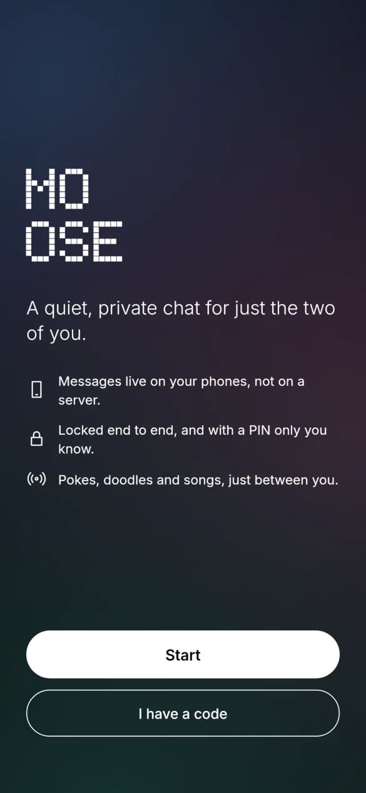 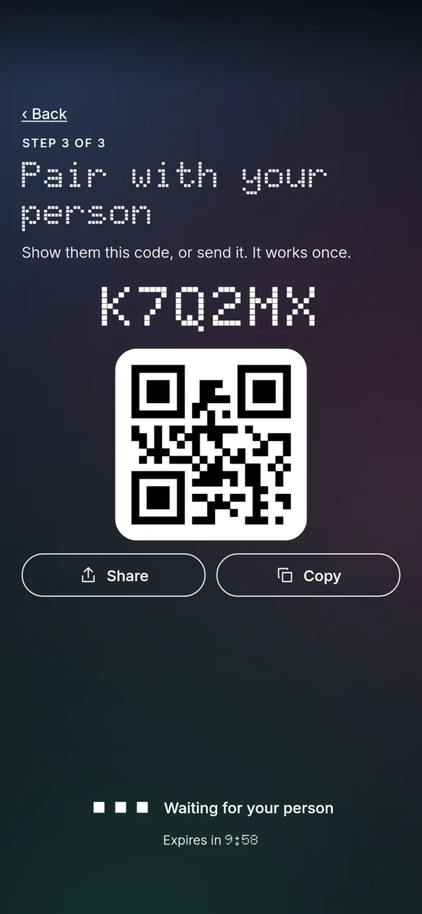 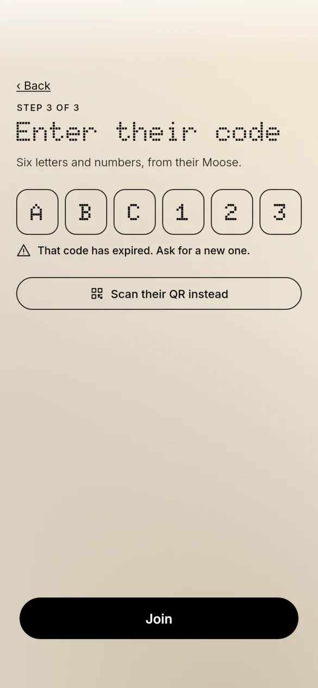 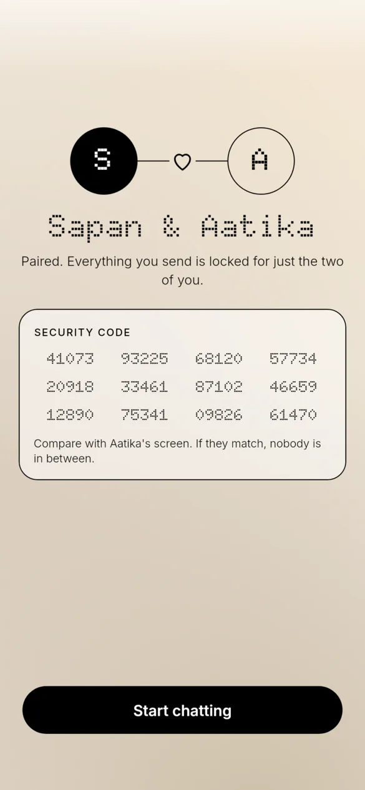

1. **Welcome:** Start, or I have a code.
2. **Your name:** your name, and an initial or a photo for your picture.
3. **Staying in touch:** asks for notifications and to skip battery optimisation, so the background check runs on time.
4. **Pair:** one phone shows a six-character code and its QR, with Share and Copy, a "Waiting for your person" loader and a 10-minute countdown. The other phone types the code, scans the QR, or picks a photo of it.
5. **Paired:** both names joined by a heart line, and the twelve-group **security code** to compare.

**Re-pair** (a new or lost phone): the new phone makes a code. The other phone opens Settings › Partner › Their new phone, types it, checks the new security code, and approves. Until then the new phone waits on C10.

Code: `features/onboarding/` (`onboarding_pages.dart`, `pair_card.dart`, `step_page.dart`). Protocol: [Delivery › Pairing](delivery.md#pairing).

## Chat

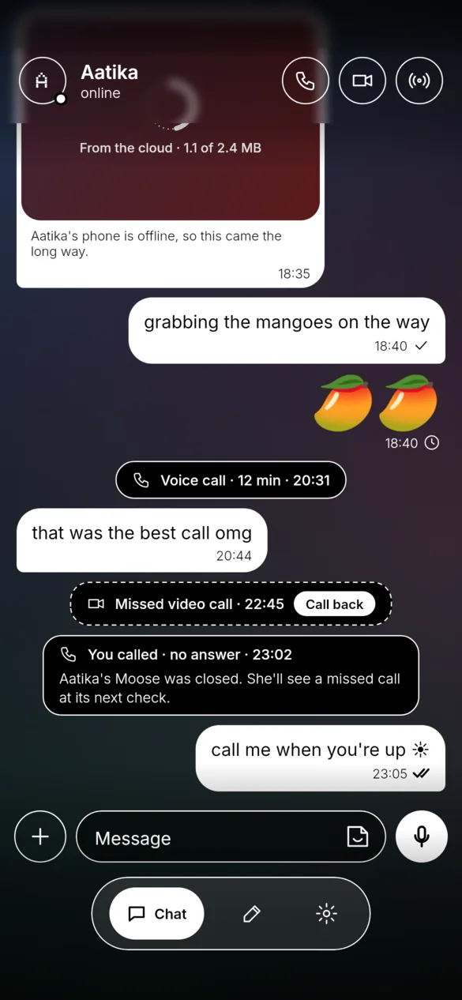 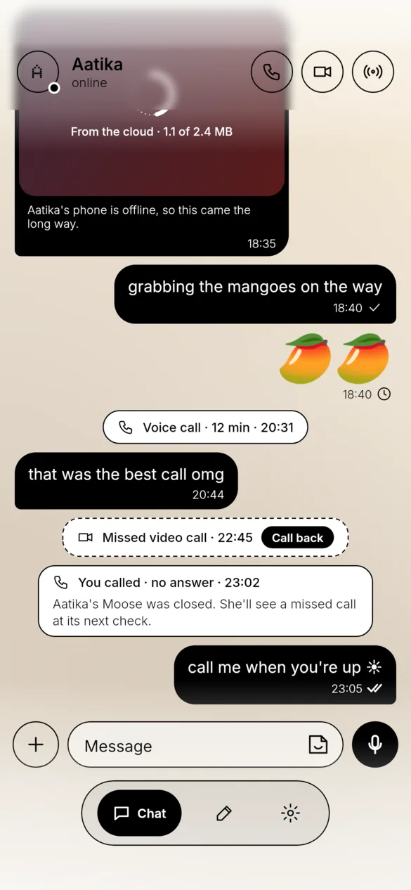 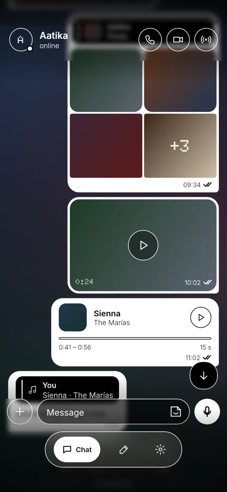 

**Header:** avatar, name, presence or typing, voice call, video call, and poke (long-press for the picker).

**Bubbles** (`features/chat/bubbles.dart`):

| Type | Notes |
| --- | --- |
| Text | Links underlined. Emoji-only messages drop the bubble and grow |
| Reply | A quote header with the quoted text, a media thumb or the song title |
| Reactions | Six quick emoji and more, shown as chips |
| Photo | Single or a 2–4 grid with "+n". Shows its source while downloading: from the cloud, with a size |
| Video | Thumbnail from the first frame, duration and play |
| Round video | A circle with a progress ring; muted autoplay |
| Voice | Play/pause, the real waveform filling as it plays, and the time counting up |
| Song | Thumbnail, title (scrolls when long), artist and the 15-second range; loading, then live progress |
| Meme / GIF | Autoplay, with a "via KLIPY" or "r/sub" caption |
| Sticker | No bubble: a white outline, a few degrees of tilt and a time chip |
| Moment | A centred row in the moment's colour |
| Call | Done, missed with Call back, or no answer |
| System | Date dividers, Unread, theme changes, Paired, New doodle |

**Ticks:** a clock while sending, ✓ sent, ✓✓ delivered, bold ✓✓ seen, and a dashed bubble with Retry if it failed.

**Gestures:** swipe a bubble to reply. Long-press for reactions, Reply, Copy, Save media, Info (sent, delivered, seen) and Delete for me. Long-press the wallpaper for the theme. A jump-to-bottom button shows the unread count.

**Composer** (`composer.dart`): + attach, the text field, stickers, then mic or send. Hold the mic to record a voice note (slide to cancel, lock for hands-free). Replying shows a quote bar. Settings › Enter sends turns Return into send.

## Media

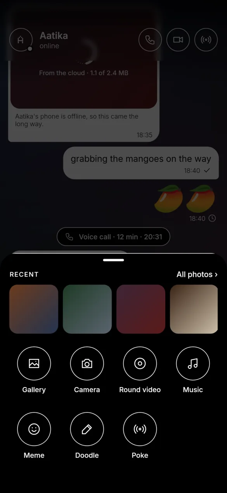 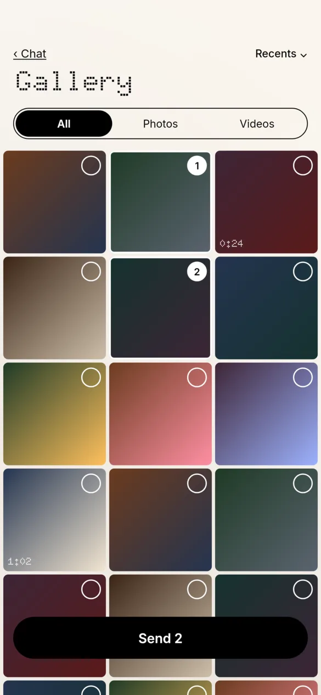 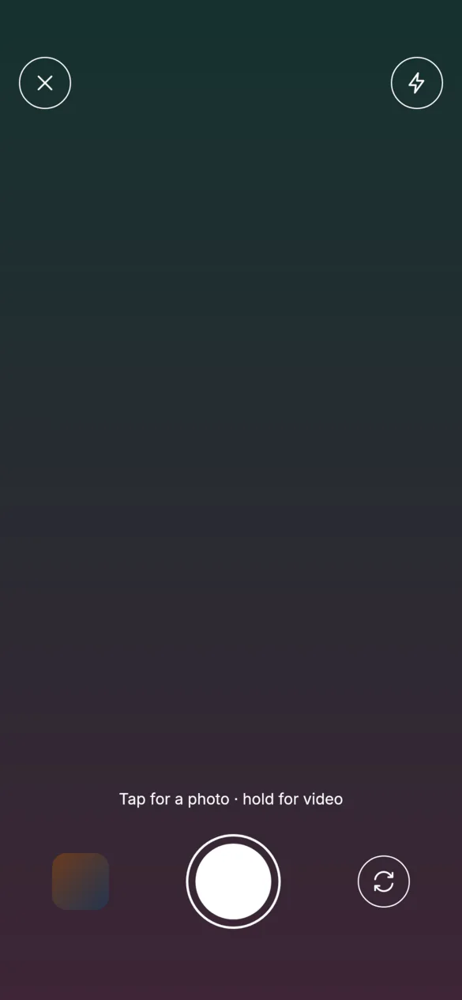 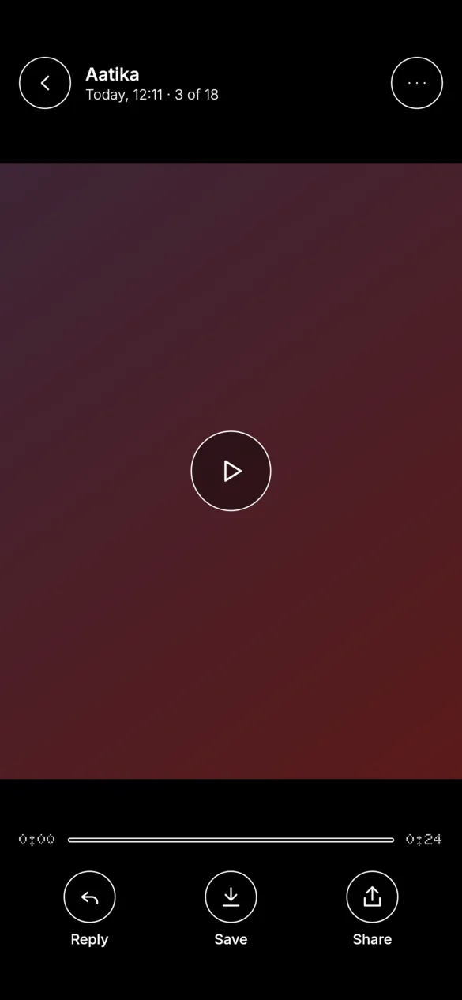

- **Attach sheet:** Gallery, Camera, Round video, Music, Meme, Doodle and Poke.
- **Photos and videos** come from the gallery (`image_picker`) or the camera, with a preview and caption before sending. Photos are compressed (`flutter_image_compress`).
- **Round video notes:** recorded with the front camera into a circle, with a limit, a swap camera button and cancel. Android only (`net/phone_round.dart`).
- **Voice notes:** AAC through `record`, with the waveform sampled while recording; played with `just_audio`.
- **Viewer:** full screen with zoom and swipe between items, the sender and time, Save (`gal`) and Share (`share_plus`), and video controls. It turns to landscape.
- **Sending:** every file is sealed with its own key and goes through storage. While it goes up, photos and videos show a ring and "Sending · 12.9 of 18.4 MB", and a round video's outer ring fills with the percentage in the middle. The upload has no overall deadline: it only gives up if nothing moves for 30 seconds. See [Security › Sealing media](security.md#sealing-media).

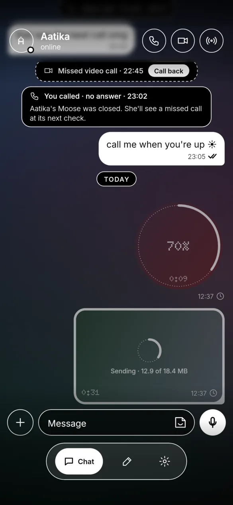 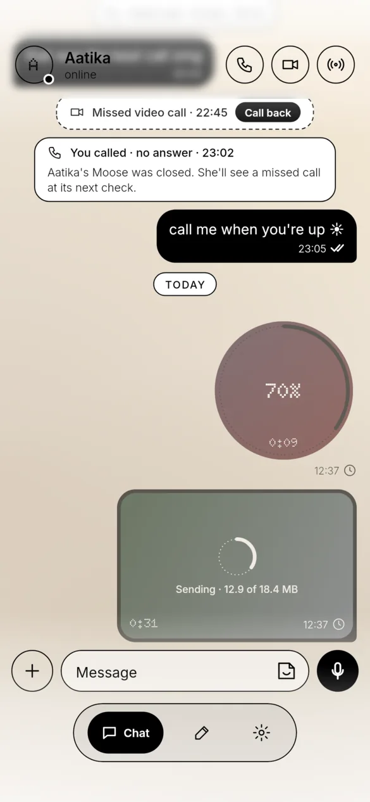
- **Auto-download:** Always, on Wi-Fi, or never (Settings › Download media).

Code: `features/media/`, `net/phone_media.dart`, `phone_voice.dart`, `phone_round.dart`.

## Songs

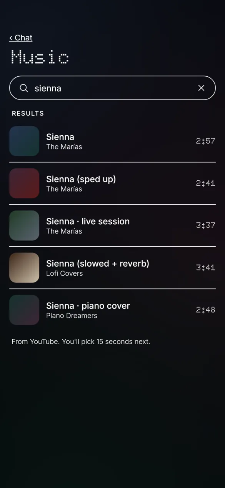 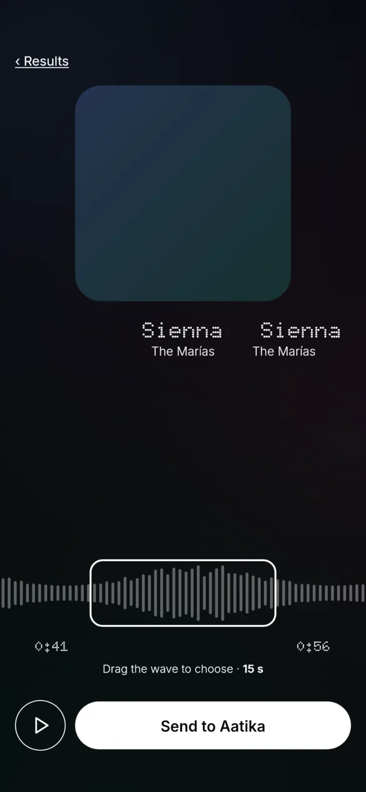 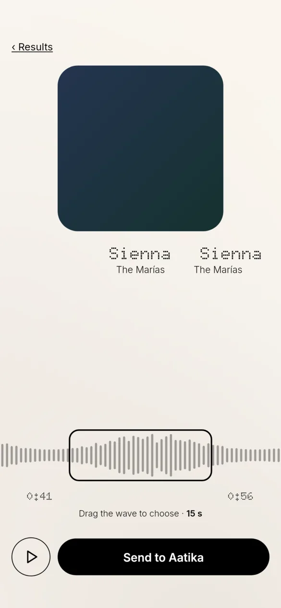

- **Search** YouTube with `youtube_explode_dart`: thumbnail, title, channel and duration.
- **Pick 15 seconds** on a scrolling wave, with a preview that plays the window and a playhead crossing it.
- **Send:** only the video id and the range travel. Each phone finds the audio stream itself, with **NewPipe Extractor first** (through `platform/youtube.dart` and `YouTubeChannel.kt`, as in Idris), falling back to youtube_explode.
- **Audio:** the audio-only stream closest to 128 kbps (`platform/quality.dart`; Best, High and Low exist in code but aren't offered in Settings yet).
- The range picker's wave is still made up, because YouTube gives no waveform (see [`mockdata.md`](../mockdata.md)).

## Memes and GIFs

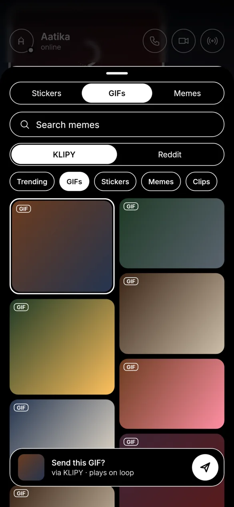 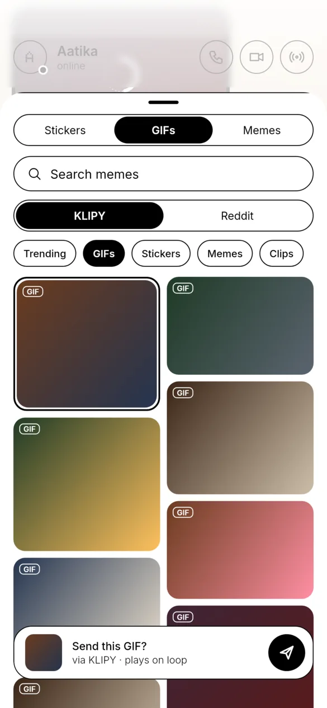

- **Reddit** memes through meme-api.com, with no key: subreddit chips such as r/wholesomememes.
- **KLIPY** GIFs, stickers, memes and clips when `MOOSE_KLIPY_KEY` is set: Trending and search.
- A sent meme carries its link, and the other phone loads it from the source.

Code: `net/web_memes.dart`, `features/stickers/tray.dart` (the GIFs and Memes tabs).

## Moments

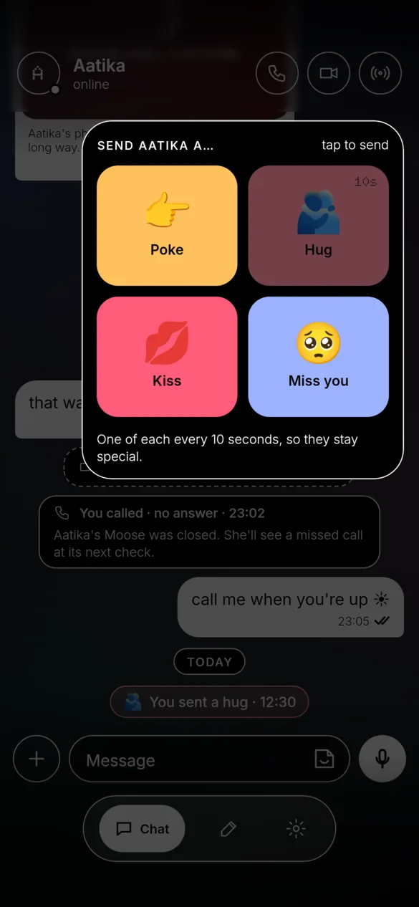 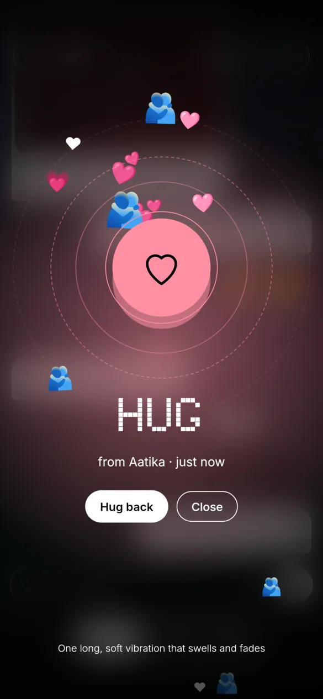 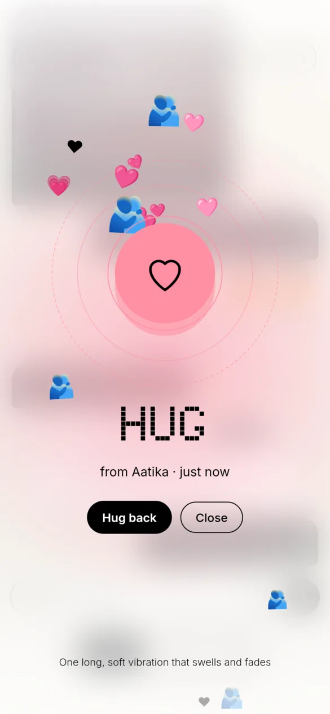

| Moment | Emoji | Colour | Haptic |
| --- | --- | --- | --- |
| Poke | 👉 | `#FFC15E` | Two quick taps |
| Hug | 🫂 | `#FF8FA3` | One long swell that fades |
| Kiss | 💋 | `#FF5C7A` | Short, short, flutter |
| Miss you | 🥺 | `#9DB2FF` | Slow heartbeat |

- **Send:** tap the poke button for a Poke, or long-press it for the picker. Each moment has a **10-second cooldown**, shown faded with its seconds left.
- **Burst:** it takes the keyboard down (and gives it back when closed), blurs the chat behind it, and shows a radial wash in the moment's colour, three rings (the outer one dashed and rippling), a centre circle that **beats like a heart**, the word in Doto, and "Hug back" / "Close". Hearts drift up across the screen and the moment's emoji floats through the middle.
- **Closed app:** a heads-up notification on the "Pokes and hugs" channel.

Code: `features/moments/` (`moment_burst.dart`, `moment_flight.dart`, `poke_picker.dart`).

## Stickers

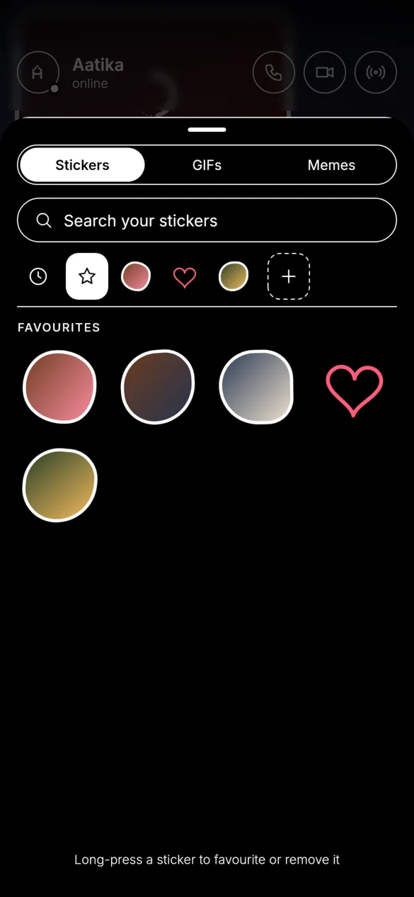 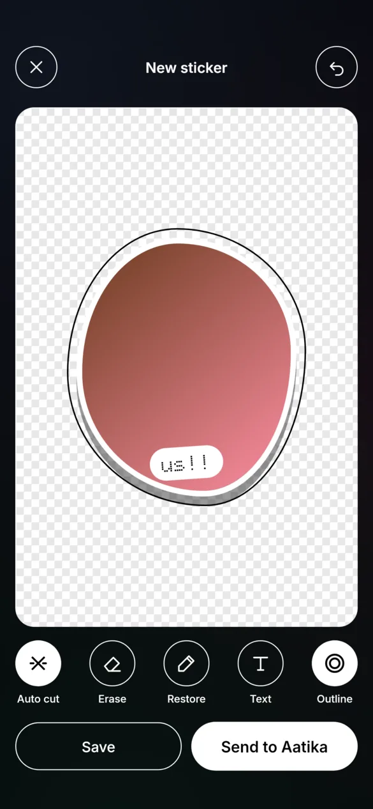 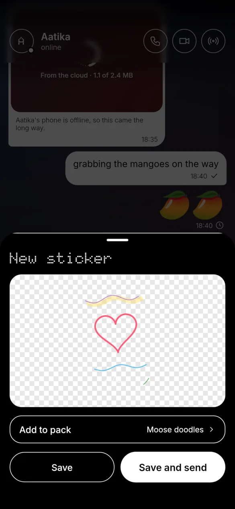 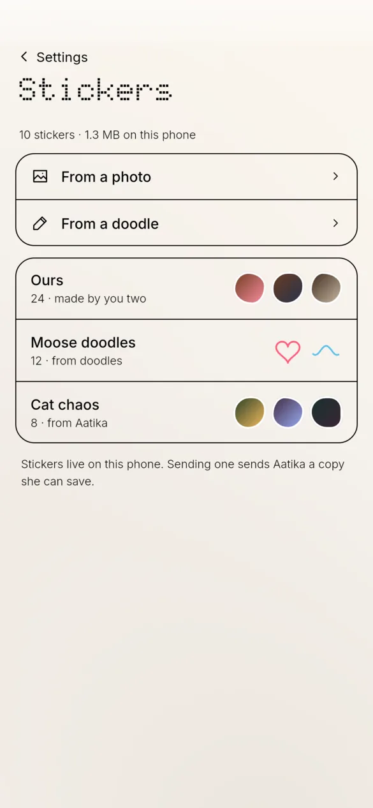

- **Tray:** a Stickers / GIFs / Memes switch, search, pack tabs (Recent, Favourites, each pack, + make) and a four-column grid. Long-press to favourite or remove.
- **From a photo:** ML Kit subject segmentation cuts the subject out automatically (`cutout.dart`; Android only). Then Erase, Restore, Text and Outline. Photo cut-outs get a thin white ring with nothing white under the subject.
- **From a doodle:** draw it, or lasso part of a board and choose Sticker. Doodle stickers are kept as strokes and **drawn exactly as drawn**, with no white rim.
- **Received stickers:** add to favourites, save one, or save the whole pack.
- **Library** (Settings › Your stickers): the count and size, and the packs. It starts with an empty "Ours" and "Saved".

Code: `features/stickers/` (`tray.dart`, `sticker_maker.dart`, `cutout.dart`), `features/common/sticker_view.dart`.

## Doodles

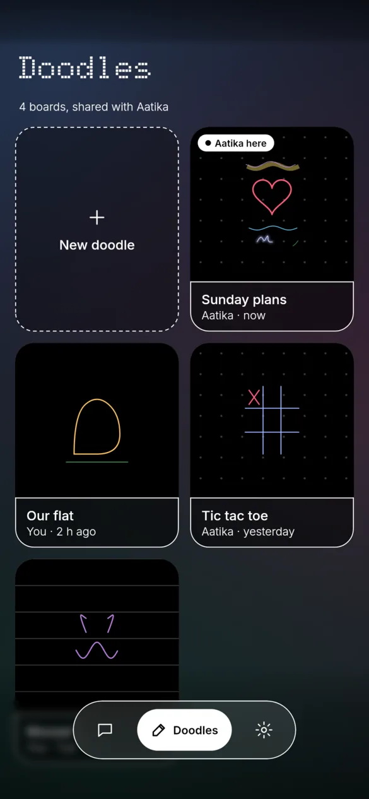 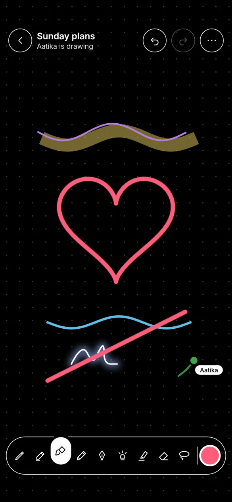 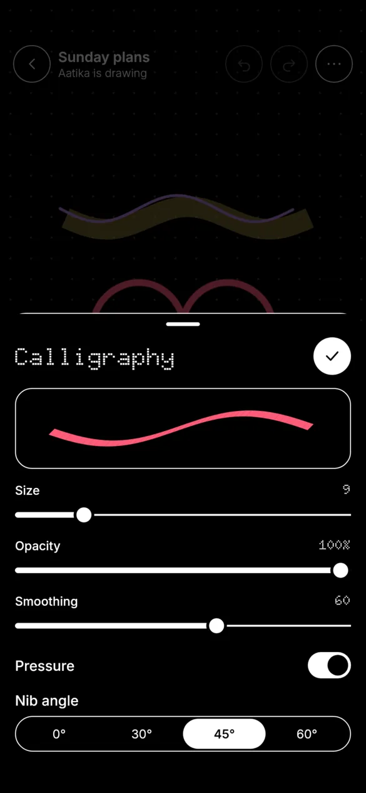 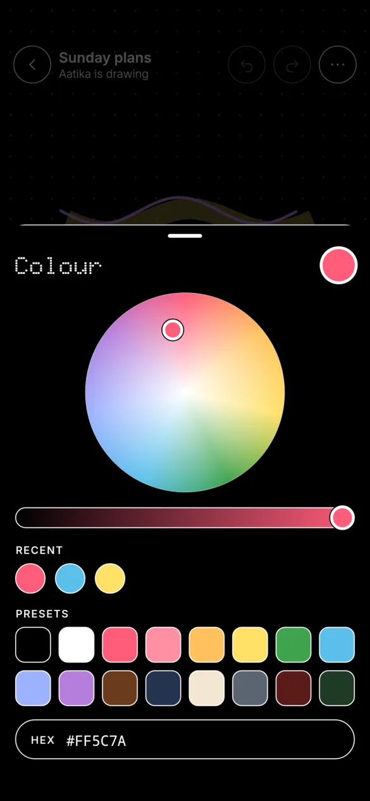

- **Gallery:** board cards with a thumbnail, name, who edited last and when, and a **live dot** when your partner has it open. Long-press to rename, delete or send to the chat.
- **New doodle:** a name, and a plain, dotted or lined background, or the chat wallpaper.
- **Board:** pan and zoom, your partner's live cursor, undo and redo, and more (export, send to chat, clear). It turns to landscape.
- **Nine tools:** fine liner, marker, brush, pencil, calligraphy, neon, highlighter, eraser and lasso.
- **Tool options:** size with a live stroke preview, opacity, smoothing, pressure, and the nib angle for calligraphy.
- **Colour:** a wheel with brightness, recent colours, presets and hex.
- **Lasso:** move, recolour, duplicate, delete, or make a sticker.
- **Sync:** each change is a sealed `doodle` envelope: create, strokes added, the whole board after an undo, erase or lasso, rename, delete and presence.

Code: `features/doodles/` (`doodles_page.dart`, `board_page.dart`, `doodle_sheets.dart`, `paper.dart`), `features/common/strokes.dart`.

## Calls

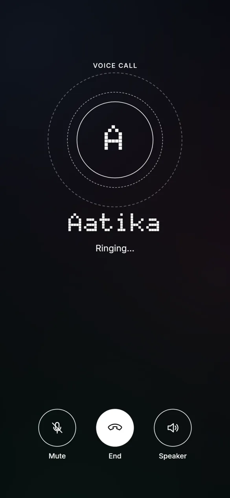 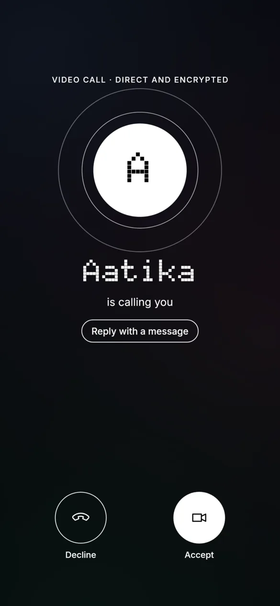 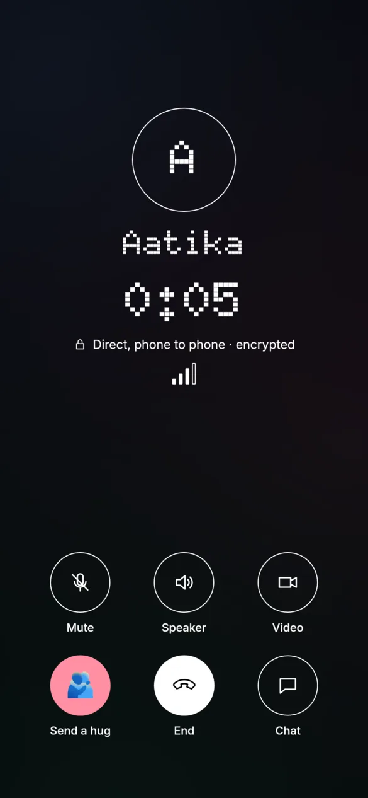 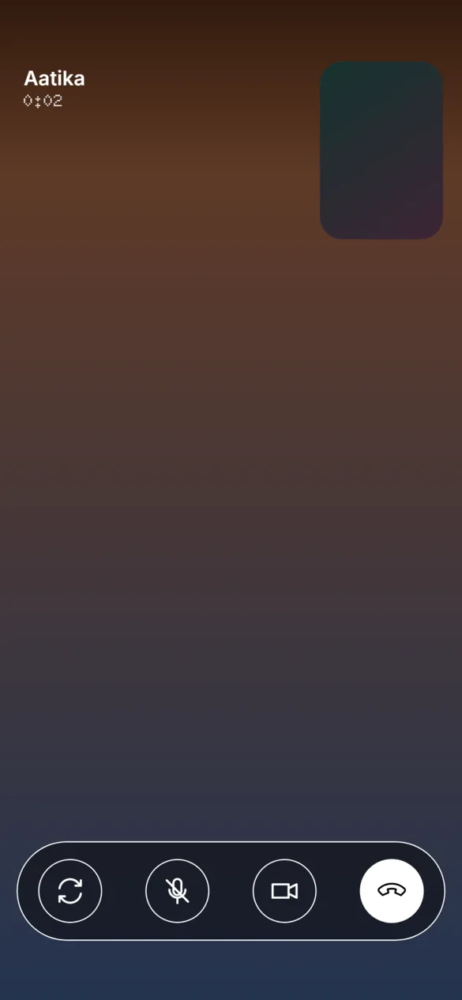

- **Voice and video**, peer to peer over WebRTC (flutter_webrtc), set up with sealed offer and answer messages.
- **Calling:** pulsing rings, Ringing…, then Mute, End and Speaker.
- **Incoming:** "direct and encrypted", Reply with a message, Decline and Accept.
- **Voice call:** a timer in Doto, signal bars, and Mute, Speaker, Video, **Send a hug**, End and Chat.
- **Video call:** your partner full screen, you in a corner, and a control bar (flip, mute, camera off, end). It's always dark and turns to landscape.
- **Limits:** STUN only, with no TURN. It only rings while your partner's Moose can be reached; otherwise it's "no answer", and they see a missed call. See [Delivery › Calls](delivery.md#calls).

## Shared theme

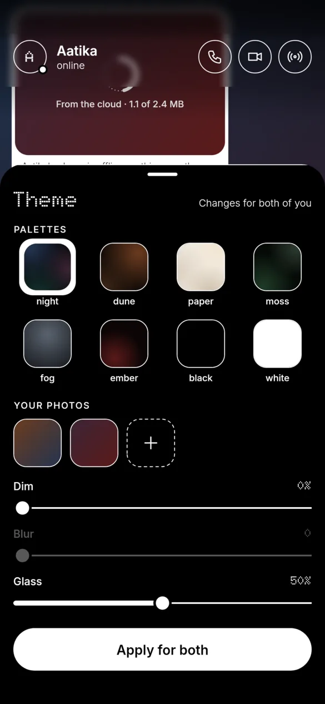 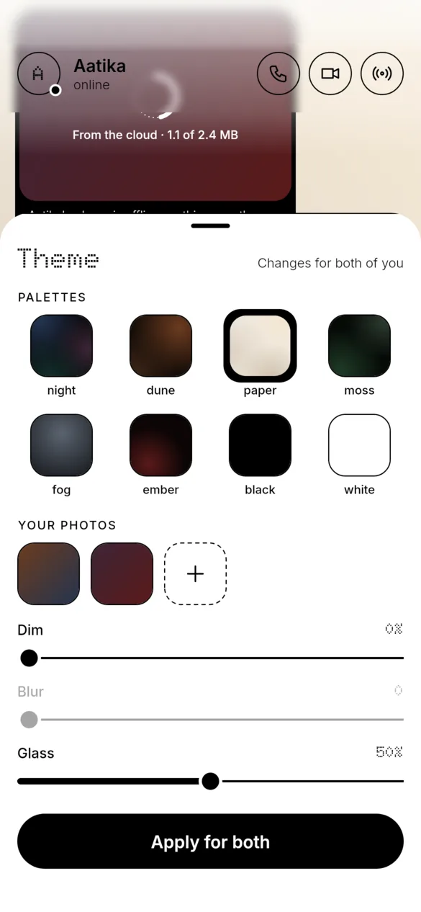

- **Eight palettes:** night (the default), dune, moss, fog, ember and black take white ink; paper and white take black ink.
- **Your photos:** add a photo wallpaper, then set dim (0–100 %) and blur. The ink follows the photo's brightness, and you can flip it.
- **Glass:** how strong the see-through panels are.
- **Apply for both:** the theme is sent sealed (a photo through storage), last change wins, and a system row records it.

Code: `features/chat/theme_sheet.dart`, `features/common/wallpaper.dart`, `app/moose_theme.dart`, `core/theme/v_palette.dart`.

## App lock and decoy

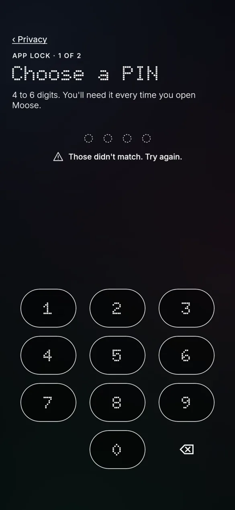 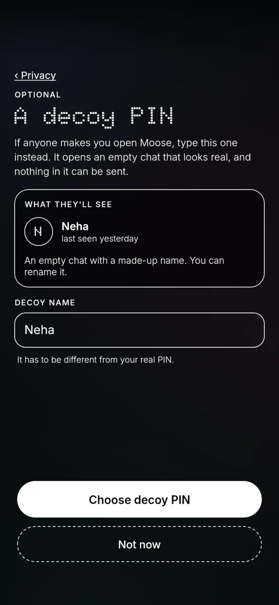 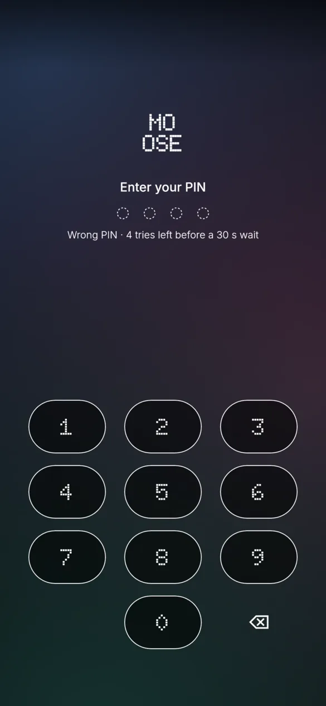

- **PIN:** set and confirm. Moose locks at launch and after a chosen time in the background. Five wrong tries mean a 30-second wait, and a wrong PIN shakes.
- **Decoy PIN:** opens an empty chat with a made-up name ("Neha" by default). Every action there is inert.
- **Hide in recent apps:** `FLAG_SECURE`.

Code: `features/lock/lock_pages.dart`, `features/common/keypad.dart`, `data/session.dart`.

## Settings

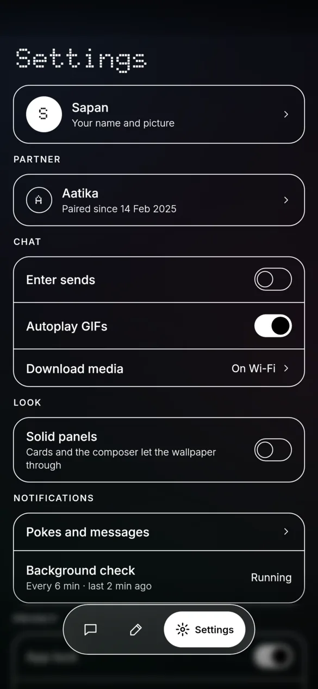 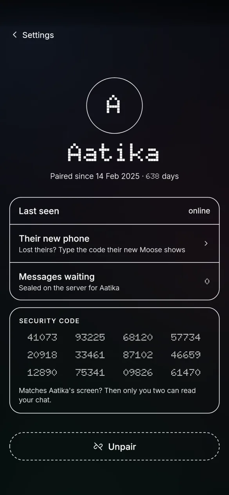 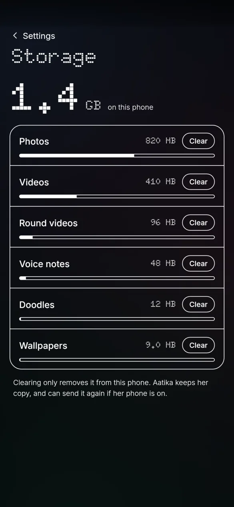 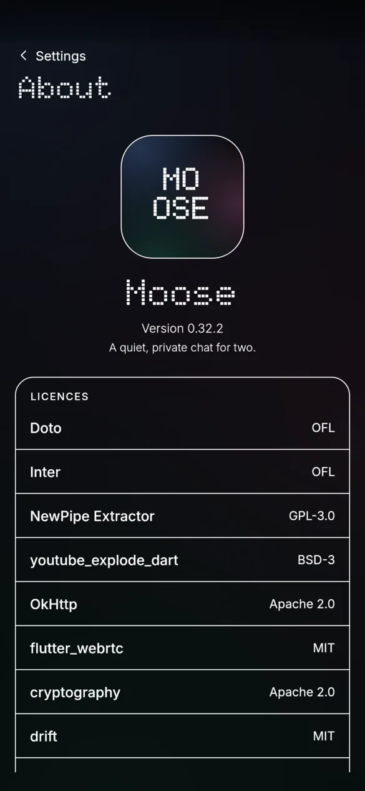

| Section | Has |
| --- | --- |
| You | Name and picture, sent sealed to your partner |
| Partner | Paired since, last seen, the security code, Their new phone (re-pair), messages waiting on the server, Unpair |
| Chat | Enter sends, Autoplay GIFs, Download media |
| Look | Solid panels (cards and composer solid instead of see-through) |
| Notifications | Message previews, per-moment sounds, and the background check's status with Fix |
| Privacy | App lock, Change PIN, Decoy PIN, Lock after, Hide in recent apps |
| Stickers | Your sticker library |
| Storage | Space by kind (photos, videos, round, voice, doodles, wallpapers), clear per kind, and Clear cache (meme and song previews) |
| About | Check for updates (Android), then the mark, version, licences (Doto, Inter, NewPipe Extractor, youtube_explode_dart, OkHttp, flutter_webrtc and more), the developer, and "See a test crash report" |

**Unpair** (C41): it says what gets deleted, asks you to type UNPAIR, and has an option to also delete the history on this phone.

Code: `features/settings/` (`settings_page.dart`, `settings_pages.dart`, `update.dart`).

## Updates

On Android, Moose checks the latest GitHub release's `update.json` at launch, on resume every 6 hours, and from Settings › Check for updates. When a newer build is out:

1. A card in Chat (it can be closed for that version) and a row in Settings open the update sheet.
2. **Update** downloads the APK with progress, resuming if it's interrupted.
3. Moose checks the **size, SHA-256, signer and versionCode** before installing.
4. **Install** uses a PackageInstaller session. The first time, Android asks to allow installing unknown apps; after that it skips its own confirm screen.
5. Afterwards there's a quiet "Moose updated" notification, and "What's new" once on the next launch.

Google Play Protect may still ask you to scan each new APK. Details are in [Releases › Over-the-air updates](releases.md#over-the-air-updates).

## Crash reports

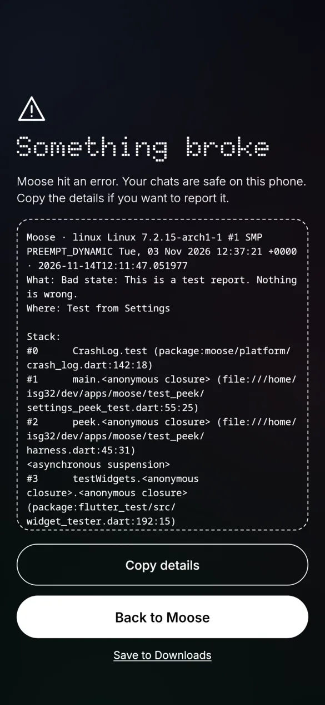 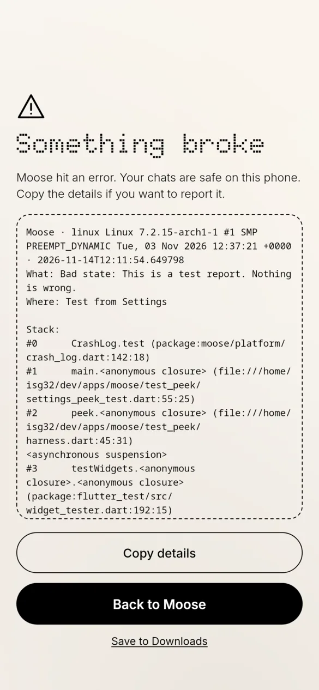

Uncaught errors (Dart, and native crashes from the last run) open a **"Something broke"** overlay with the full report: version, device, what, where and the stack. You can copy it, save it to Downloads, or go back to Moose. Settings › About › See a test crash report shows one on purpose.

Code: `features/crash_overlay.dart`, `platform/crash_log.dart`, `CrashFiles.kt`.
