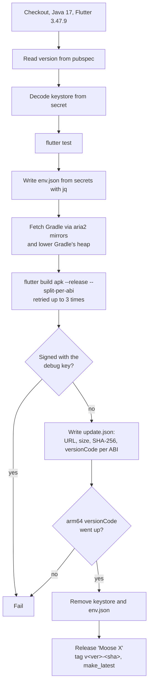
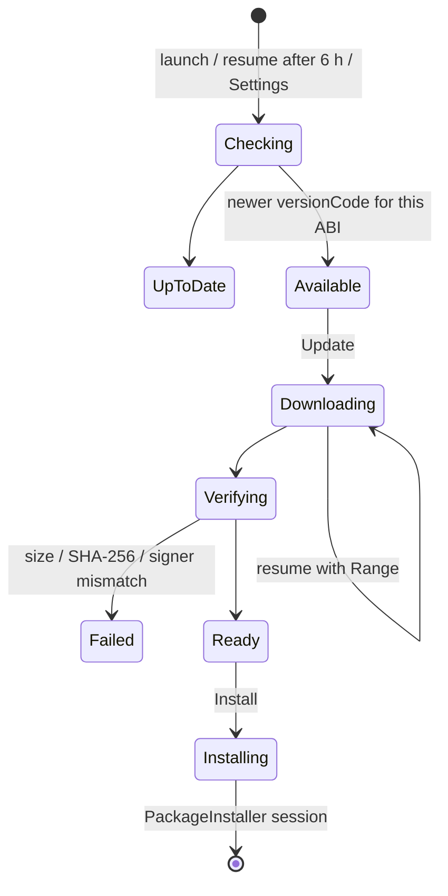

# Releases and OTA

Every push to `main` builds, tests, signs and publishes a GitHub release, and installed copies of Moose update themselves from it.

## Versioning

Bump the version **on every push to main**, in three places:

| File | What |
| --- | --- |
| `pubspec.yaml` | `version: 0.32.2+41` (name + build number) |
| `lib/app/version.dart` | `mooseVersion` |
| `test/settings_test.dart` | The expected "Version 0.32.2 · licences, developer" |

`test/version_test.dart` checks that they agree.

**versionCodes:** `--split-per-abi` adds 1000 × the ABI index to the build number, so build 41 becomes:

| ABI | versionCode |
| --- | --- |
| armeabi-v7a | 1041 |
| arm64-v8a | 2041 |
| x86_64 | 4041 |

CI **fails on purpose** if the arm64 versionCode isn't above the last release's, because a release no phone can install would sit there as "latest" and offer nothing.

**Commits** are in Cariño style: a sentence-case subject with the version (`Fix X (0.32.2)`), and a body saying what changed and why. Commit subjects since the last release become the update's "What's new".

## The release workflow

`.github/workflows/release.yml`: on push to `main`, in the GitHub environment `deployment`, with a 45-minute limit. A newer push cancels a running one.



- **Gradle memory** is turned down for the runner: the old 8 GB heap made it lose contact and die.
- **Gradle itself** is fetched with aria2 from mirrors, because the default download timed out on cold caches.
- There's **no AppImage or Linux release**; the Linux build is for development.

### Secrets (environment `deployment`)

| Secret | For |
| --- | --- |
| `MOOSE_KEYSTORE_BASE64` | The release keystore, base64 |
| `MOOSE_KEYSTORE_PASSWORD`, `MOOSE_KEY_PASSWORD` | Its passwords |
| `MOOSE_KEY_ALIAS` | `upload` |
| `MOOSE_API_URL`, `MOOSE_AUTH_URL` | The Neon Function and Managed Auth |
| `MOOSE_KLIPY_KEY` | KLIPY GIFs (optional) |

`android/app/build.gradle.kts` reads the `MOOSE_KEYSTORE_*` and `MOOSE_KEY_*` variables, and falls back to the debug key when they're missing, so local debug builds still work.

### The release key

Releases from **0.31.0** onward are signed with the release key, which lives outside the repo. Android only installs an update signed by the same key, so:

- **Never lose it.** Without it, every user would have to uninstall (losing their chats) to move to a new key.
- A phone with a release-signed install can't take a debug-signed build over it without wiping its data. To test locally, build release-signed too (see [Development](development.md#on-the-phone)).

## `update.json`

Published with every release, at `https://github.com/isg32/moose/releases/latest/download/update.json`:

```json
{
  "version": "0.32.2",
  "build": 41,
  "published": "2026-11-14T…Z",
  "notes": ["Keep covered setup steps alive, so a scanned QR pairs", "…"],
  "apks": {
    "arm64-v8a":   {"url": "https://github.com/isg32/moose/releases/download/v0.32.2-63a4ad8/app-arm64-v8a-release.apk",
                    "sha256": "…", "size": 0, "versionCode": 2041},
    "armeabi-v7a": {"…": "…"},
    "x86_64":      {"…": "…"}
  }
}
```

The versionCode is read from each APK with `aapt2 dump badging`, not computed.

## Over-the-air updates

`lib/net/updater.dart` (Dart), `lib/platform/updater_channel.dart` and `android/…/Updater.kt` (Kotlin).



1. **Check:** read `update.json` (a build can point elsewhere with `--dart-define=MOOSE_UPDATE_URL=…`), pick this phone's ABI, and compare versionCodes. This runs at launch, on resume if 6 hours have passed, and from Settings › Check for updates.
2. **Prompt:** a card in Chat (dismissed per version) and a row in Settings both open the update sheet.
3. **Download:** with progress, following redirects by hand and **resuming with Range headers** after a drop.
4. **Verify:** the size and SHA-256 must match `update.json`, the APK's **signer must match the installed app** (`sameSigner`), and its versionCode must be higher.
5. **Install:** the first time, Android asks to allow "Install unknown apps" for Moose. Then a **PackageInstaller session** installs it. After the first self-install, Android skips its own confirm screen.
6. **After:** `UpdatedReceiver` posts a quiet "Moose updated to X" notification, and "What's new" shows once on the next launch.

**Google Play Protect** may still show "App scan recommended" for each new APK. That's Play Protect's decision about apps from outside the Play Store; the user taps Scan app.

### Testing an update locally

```bash
# A Range-capable static server with update.json and the APK in it
python3 -m http.server 8765        # or any server that supports Range
adb reverse tcp:8765 tcp:8765
flutter build apk --release --split-per-abi --target-platform android-arm64 \
  --dart-define-from-file=env.json --dart-define=MOOSE_UPDATE_URL=http://127.0.0.1:8765/update.json
```

Install an older build with that define, put a newer APK and its `update.json` on the server, then use Settings › Check for updates. Python's built-in `http.server` doesn't support Range, so use a small Range-capable one to test resuming.
